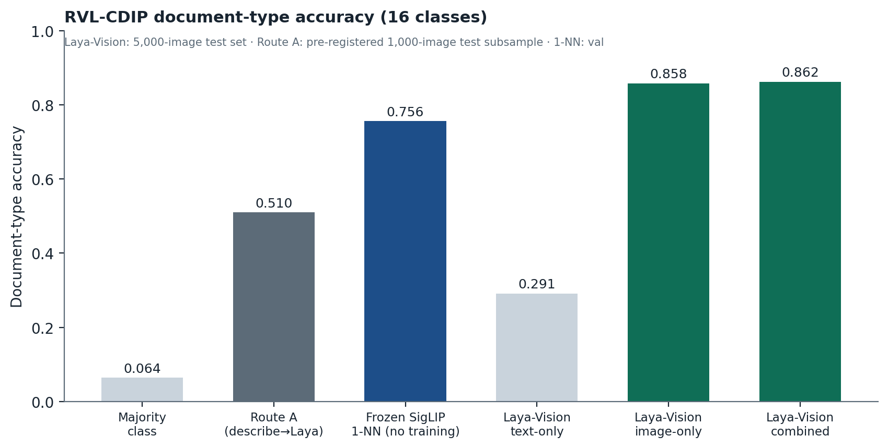
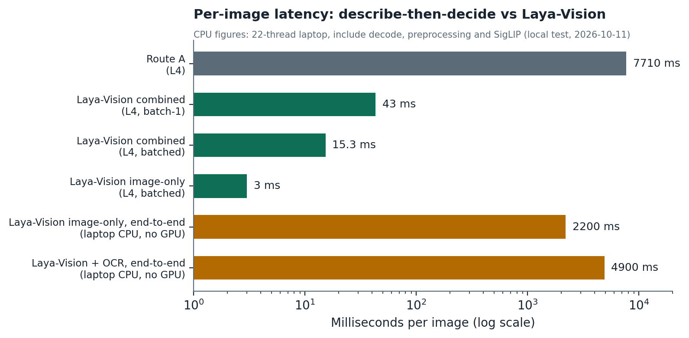
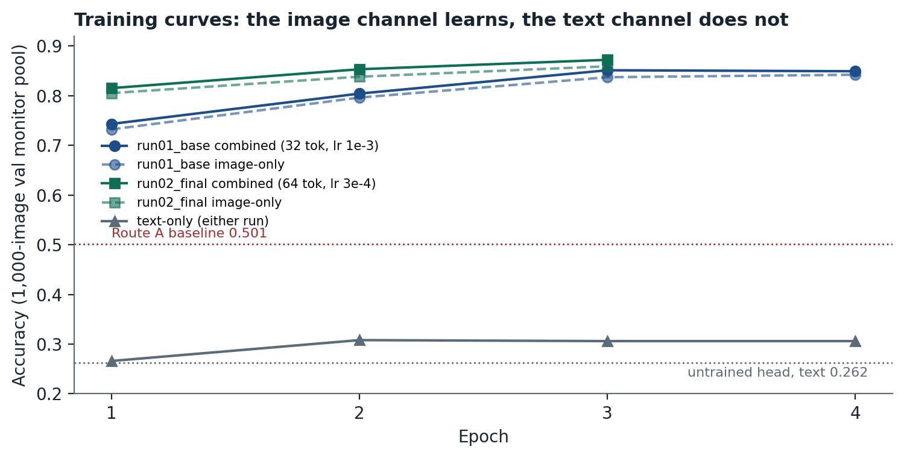

# Laya-Vision

**A document decision model that can see.** Laya-Vision extends the open-source
[Laya](https://huggingface.co/convaiinnovations/laya) decision model (a "System 1"
model that returns typed, calibrated decisions instead of text) with an image
input channel. Give it a scanned page and a typed question — a choice from a list,
a score on a scale, or a yes/no probability — and it answers in ~15 ms per page on
a modest GPU, or ~2.2 s end-to-end on a laptop CPU, with a confidence you can set policy
against. The shipped task is 16-class document-type classification on RVL-CDIP:
**86.2% test accuracy, calibration error 0.015**, versus 51% for the obvious
describe-the-image-then-decide alternative at ~500× the GPU cost.

Built by one person on Google Colab in five gated phases, with every decision,
experiment and result recorded in this repository.

**Model on Hugging Face:** https://huggingface.co/savita10/laya-vision

---

## What this model does — and doesn't

### It does
- Looks at a scanned document image and answers **typed questions** whose answer
  space you define in advance: a choice from a list, a score on a scale, or a
  yes/no probability (Laya's three primitives).
- Shipped task: **16-class document-type classification** (RVL-CDIP classes:
  letter, form, email, handwritten, advertisement, scientific report, scientific
  publication, specification, file folder, news article, budget, invoice,
  presentation, questionnaire, resume, memo), with calibrated confidence.
- Fast: ~15 ms/page batched on an L4, ~43 ms single, ~2.2 s end-to-end on a
  laptop CPU (~5 s with OCR).
- Accepts image only, text only, or both. **Image-only is recommended** — OCR text
  adds under 0.5 points and costs 5× the batched latency.
- You can ask new typed questions at request time without retraining — but
  accuracy on questions it was not trained on is **not measured** and must be
  validated on your own data. Probabilities for untrained questions are
  returned uncalibrated (T = 1.0, `"calibrated": false` in the answer).

### It does not
- **Extract or read values.** It cannot tell you an invoice total, a date, a name,
  or any text on the page. It returns decisions, never free text. For extraction,
  pair it with OCR or a vision-language model (see *Where it fits*).
- Know document types outside the 16 classes; anything else is forced into the
  nearest class. Fine-tune on your own labelled examples to add types.
- Work reliably off-distribution. It is trained on RVL-CDIP: 1960s–90s
  tobacco-industry documents, greyscale, ~90 dpi. Modern colour PDFs, phone photos
  and screenshots are out of distribution — expect lower accuracy and validate
  first.
- Understand non-document images. They produce meaningless but confident-looking
  answers.
- Detect handwriting or judge legibility (explored and deferred; see
  `DECISIONS.md`).

### Where it fits: fast gate, then extraction

```
scanned page ──▶ Laya-Vision: type? queue? confidence?        ~15 ms/page
                    ├── confidence ≥ threshold ──▶ route automatically
                    ├── below threshold        ──▶ human review
                    └── invoices (say)         ──▶ OCR / VLM extraction of totals, dates
```

The decision model handles every page in milliseconds; the expensive reading step
runs only on the fraction that needs it. Thresholds are yours to set — the
calibrated probabilities are what make that safe.

---

## Results

All numbers from a single pre-registered evaluation
([`docs/phase4_protocol.md`](docs/phase4_protocol.md)); the test set was read once.

| System | Data | Accuracy | ECE (cal.) | Latency / image |
|---|---|---|---|---|
| **Laya-Vision, combined** | test, 5,000 | **0.862** | 0.015 | 15.3 ms batched · 43 ms batch-1 (L4) · ~2.2 s CPU end-to-end¹ |
| Laya-Vision, image-only | test, 5,000 | 0.858 | 0.014 | 3.0 ms batched · 42 ms batch-1 (L4) |
| Laya-Vision, text-only (OCR) | test, 5,000 | 0.291 | 0.034 | 15.6 ms batched |
| Laya-Vision, combined | same 1,000 test ids as Route A | 0.873 | — | — |
| Route A: VLM describes → Laya decides | test subsample, 1,000 | 0.510 | — | 7,710 ms (L4) |
| Laya-Vision, combined | val comparison set, 2,000 | 0.847 | 0.019 | 14.8 ms batched |
| Route A | val comparison set, 2,000 | 0.501 | — | 7,600 ms |
| Frozen SigLIP 1-NN (no training) | val, 5,000 | 0.756 | — | — |
| Majority class | — | 0.064 | — | — |

¹ CPU: ~2.2 s per page end-to-end on a laptop CPU (22 logical CPUs; decode + preprocessing + SigLIP + forward), ~5 s with OCR. The 875 ms figure in docs/final/ is the Laya forward alone over precomputed embeddings on a 12-vCPU Colab host. GPU latencies are the model forward over precomputed embeddings
(batched, L4).

Local CPU verification of the shipped release on the 1,000-image test subsample: image-only accuracy 0.864 (matches the L4), 0 errors, calibration monotone, no network access after the one-off SigLIP download.





Per-class, ablations, calibration and confusion matrices:
[`docs/final/`](docs/final/), [`docs/figures/`](docs/figures/), `experiments.md`.

### Comparison to published results

| Model (year) | Modality | RVL-CDIP test acc. | Source |
|---|---|---|---|
| Bi-VLDoc (2022) | image + text + layout | 97.12 | Luo et al. 2022, as tabulated in Larson et al., EACL 2023, Table 1 |
| ERNIE-Layout-large (2022) | image + text + layout | 96.27 | Larson et al. 2023, Table 1 |
| LayoutLMv3-large (2022) | image + text + layout | 95.93 | Larson et al. 2023, Table 1 |
| DocXClassifierFPN-XL (2024) | image | 94.19 | Saifullah et al., IJDAR 2024 |
| VGG-16 fine-tuned (2017) | image | 90.97 | Afzal et al., ICDAR 2017 |
| Harley et al. (2015, dataset paper) | image | 89.80 | Harley et al., ICDAR 2015 |
| **Laya-Vision v1 (2026)** | image (+ inert OCR text) | **86.24** | this work — 5,000-image stratified test subsample |
| Route A: describe → Laya | image via VLM text | 51.0 | this work — 1,000-image test subsample |

Three things make this a fair rather than flattering comparison:

1. **Training data.** Every leaderboard entry trains on the full 320,000-image
   train split; Laya-Vision used a 60,000-image stratified subsample (a compute
   budget decision, not a ceiling).
2. **What was trained.** Leaderboard models fine-tune hundreds of millions of
   parameters end-to-end at full resolution, several with layout features.
   Laya-Vision trains a 28M-parameter adapter (projector + decision head) over a
   **frozen** encoder, from a 64-token, 384-px summary of the page.
3. **Objective.** The leaderboard optimises accuracy alone. Laya-Vision targets
   calibrated typed decisions at ~15 ms/page; calibration and latency are not
   reported comparably by those papers.

Label-noise note: Larson et al. (2023) estimate **8.1% label errors in the
RVL-CDIP test split** — higher than the error rate of the top models, which
therefore partly fit noise. Our own 200-image audit found ~2% clear mislabels plus
~1.5% unreadable pages.

Planned for v1.1: evaluation on the full 40,000-image test set; training on the
full 320,000-image train split.

---

## Quickstart

### 1. Install
```bash
pip install laya==0.3.24 transformers==4.49.0 torch pillow huggingface_hub
# optional, for the combined image+text view:
sudo apt-get install tesseract-ocr && pip install pytesseract
```

### 2. Get the code and weights
```bash
git clone https://github.com/savita10/laya-vision
cd laya-vision
pip install -e .
python -c "from huggingface_hub import snapshot_download; snapshot_download('savita10/laya-vision', local_dir='release')"
```
The release is ~960 MB (it includes the fine-tuned Laya base); SigLIP
(`google/siglip-base-patch16-384`) downloads on first run.

### 3. Classify a folder of document images
```bash
python scripts/demo.py --images ./my_scans --release release/ --out results.json
```
Prints, per image, the predicted type among the 16 classes and its calibrated
probability. Add `--with-ocr` for the combined view (needs Tesseract).

### 4. Use it in Python
```python
from laya_vision import VisionAgent

agent = VisionAgent(release_dir="release")
result = agent.predict(
    image="invoice.png",
    questions={
        "doc_type": {
            "type": "choice",
            "instructions": "What type of document is this?",
            "criteria": ["letter", "form", "email", "handwritten", "advertisement",
                         "scientific report", "scientific publication", "specification",
                         "file folder", "news article", "budget", "invoice",
                         "presentation", "questionnaire", "resume", "memo"],
        }
    },
)
ans = result["answers"]["doc_type"]
print(ans["choice"], ans["probabilities"][ans["choice"]])
```
`image=None` runs upstream Laya's exact text-only path on Laya-Vision's weights.

### Input formats
Any Pillow-readable raster image — PNG, JPEG, TIFF, BMP, WebP — as a path or a PIL
image; greyscale or colour; any size or aspect ratio (letterboxed to 384×384
internally, OCR runs on the original). PDFs must be rendered to images first
(e.g. `pdf2image` or `pypdfium2` at ~150 dpi). Multi-page TIFFs: first page only.
Images whose long side is below ~384 px are upscaled and lose detail.
OCR (`--with-ocr` / `ocr=True`): the SDK warns when the local Tesseract version
differs from training's 5.3.4; text may differ slightly.

---

## Honest limits

- **The text channel is inert.** OCR text adds ≤0.4 points over image-only across
  every run; text-only accuracy (0.29) barely exceeds an untrained head (0.26).
  Deploy image-only unless text is free. Form vs questionnaire is the one
  neighbourhood where image-only beats combined (0.783 vs 0.755).
- **Weak on visually similar classes:** scientific report (0.67), form (0.72),
  letter (0.78), questionnaire (0.79), presentation (0.81) on the val comparison
  set — the report/publication, form/questionnaire and letter/memo/email
  neighbourhoods. Strongest: email (0.97), resume (0.93), advertisement (0.92).
- **Per-class figures are indicative:** specification scored 0.758 image-only on the 1,000-image test subsample (0.873 image-only, 0.897 combined on the val comparison set) - per-class accuracy varies by sample; treat per-class figures as indicative.
- **CPU latency:** ~2.2 s per page end-to-end on a laptop CPU (22 logical CPUs; decode + preprocessing + SigLIP + forward), ~5 s with OCR. The 875 ms figure in docs/final/ is the Laya forward alone over precomputed embeddings on a 12-vCPU Colab host.
- **Domain:** RVL-CDIP vintage, greyscale, ~90 dpi. Validate before use on modern
  documents.
- **Accuracy ceiling:** ~2% label noise + ~1.5% illegible pages in the training
  data cap meaningful accuracy around 96–97%.
- **Temperatures:** published text-view numbers are at T = 1.0 (fitting made the
  weak text view slightly worse). The SDK's `image=None` path applies upstream
  Laya's own fitted temperature for choice questions (1.060); both are recorded
  in `release/laya_vision_config.json`.
- **Test set:** results are on a 5,000-image stratified subsample of the
  40,000-image RVL-CDIP test split.
- With `image=None`, upstream's path uses the base model's max_len of
  1024; the published text-view numbers used 512. Results differ only for
  pages longer than ~460 OCR tokens.
- **Not a reader.** See *What it does — and doesn't*.

---

## How it was built

Five gated phases; each gate's conditions and results are in
[`DECISIONS.md`](DECISIONS.md), every training run in
[`experiments.md`](experiments.md).

| Phase | What | Gate |
|---|---|---|
| 0 | Reproduce upstream Laya's fine-tune (0.777 vs published 0.766) | ✅ |
| 1 | Dataset (60k/5k/5k, SHA-pinned), 200-image hand audit, Route A baseline 0.501 | ✅ |
| 2 | One-off precompute: Tesseract OCR + frozen SigLIP embeddings, 36 shards, 7 GB | ✅ |
| 3 | Projector + head training, ablations (tokens, lr, modality mix) → run02_final | ✅ |
| 4 | Calibration, pre-registered protocol, one touch of the test set | ✅ |
| 5 | This release | ✅ |

Architecture: a frozen SigLIP-base-384 encoder → 8×8 average-pooled patch grid
(64 tokens, fp16) → trained 2-layer projector (768→1024) → slots at the start of
Laya's state → frozen ModernBERT-large encoder → trained decision head (option
markers at `[MASK]` tokens). Input order is fixed: `[visual | OCR text |
features | user text]`; text truncates first, visual tokens and options never.
Trained with upstream's RLCD objective (proper scoring rules), bf16, modality
dropout 40/30/30 (combined / image-only / text-only). Details:
[`docs/phase3_design.md`](docs/phase3_design.md).

Compute: ~10 GPU-hours (NVIDIA L4, Google Colab) for training and ablations plus
~3 hours of precompute; label generation experiments ~2 hours. Total under 20
GPU-hours.

---

## Repository map

- `laya_vision/` — installable package: `VisionAgent`, model, projector, loader
- `scripts/` — converter, precompute, training, evaluation, calibration, demo
- `notebooks/` — Colab launchers (code lives in `scripts/`; notebooks only run it)
- `docs/` — dataset card, model card, phase designs, evaluation protocol, figures,
  final results
- `splits/` — pre-registered comparison sets (val 2,000; test 1,000), SHA-guarded
- `docs/PROJECT_SPEC.md` — the project spec the coding agent worked from
- `DECISIONS.md` / `experiments.md` — the audit trail

## Credits and licence

Apache-2.0 — see `LICENSE` and `NOTICE`.

- **Laya** by Convai Innovations (Apache-2.0) — the decision model, training
  objective and interface this work extends. Laya-Vision's `image=None` path is
  upstream's exact code on retrained weights.
- **SigLIP** (`google/siglip-base-patch16-384`) by Google (Apache-2.0) — the frozen
  vision encoder.
- **RVL-CDIP** (Harley, Ufkes & Derpanis, ICDAR 2015) — training and evaluation
  data; distributed for research use. A model trained on it inherits that context.
- **Tesseract** (Apache-2.0) — OCR for the optional text channel.

## References

- Harley, A. W., Ufkes, A., Derpanis, K. G. (2015). *Evaluation of Deep
  Convolutional Nets for Document Image Classification and Retrieval.* 13th
  International Conference on Document Analysis and Recognition (ICDAR), IEEE,
  pp. 991–995. doi:10.1109/ICDAR.2015.7333910. arXiv:1502.07058.
- Afzal, M. Z. et al. (2017). *Cutting the Error by Half: Investigation of Very
  Deep CNN and Advanced Training Strategies for Document Image Classification.*
  14th IAPR International Conference on Document Analysis and Recognition (ICDAR),
  IEEE, vol. 1, pp. 883–888. arXiv:1704.03557.
- Larson, S., Lim, G., Leach, K. (2023). *On Evaluation of Document
  Classification with RVL-CDIP.* Proceedings of the 17th Conference of the
  European Chapter of the Association for Computational Linguistics (EACL),
  Dubrovnik, pp. 2665–2678. doi:10.18653/v1/2023.eacl-main.195. (arXiv preprint
  2306.12550 carries the title variant "…using RVL-CDIP".)
- Saifullah, S., Agne, S., Dengel, A., Ahmed, S. (2024). *DocXclassifier: towards
  a robust and interpretable deep neural network for document image
  classification.* International Journal on Document Analysis and Recognition
  (IJDAR) 27(3):447–473. doi:10.1007/s10032-024-00483-w.
- Zhai, X., Mustafa, B., Kolesnikov, A., Beyer, L. (2023). *Sigmoid Loss for
  Language Image Pre-Training.* Proceedings of the IEEE/CVF International
  Conference on Computer Vision (ICCV), pp. 11975–11986. arXiv:2303.15343.
